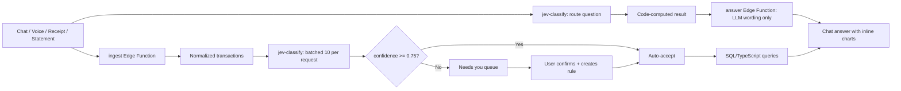

# Talk-to-Your-Money

A chat-first personal finance agent. Log expenses by typing, by voice, or with a receipt photo. Import bank statements (CSV or PDF). **Jev** (TypeSafe AI's fast decision model) categorizes transactions in batches of 10 per request with calibrated confidence. Ask "Where did my money go in September?" and Jev routes the question to a fixed set of **code-computed queries** — every total, average, and budget number comes from SQL/TypeScript, never from a model.

**Jev categorizes and routes, code does the math, the LLM talks.**

## Overview

- **Chat panel** (left): type expenses ("lunch 14.50 at Chipotle"), record voice, upload receipt photos, or ask questions about spending
- **Dashboard** (right): this month vs. last month, category donut, monthly bar chart, top merchants, recurring charges, budget progress bars
- **Needs you**: review queue for low-confidence categorizations, with Jev's top 3 options as probability-bar buttons
- **Transactions**: searchable table with category chips, confidence dots, source icons, inline edit
- **Import**: drag-and-drop CSV/PDF with column-mapping preview and "Categorize with Jev" progress bar
- **Stats**: Jev calls, batches, auto-accept rate, cost comparison vs. LLM-per-transaction

## How it works



## Rules & scope

### Hard rules
1. **Numbers come from code only.** The LLM receives computed figures and must not invent or recompute amounts. Code checks that every number in the LLM answer appears in the computed result, and replaces the answer with a template if it doesn't.
2. **Demo data only.** No bank connections, logins, or account numbers. A "Delete all my data" button wipes everything. Card/account numbers are masked (last 4 kept) before storing or sending to Jev/LLM.
3. **Untrusted data.** User text, receipts, and statements are wrapped as data in every Jev and LLM call. Instruction-like text is flagged, not obeyed.
4. **Daily cap:** 200 calls per Edge Function per day via `usage_counters` table. RLS enabled with no anon/authenticated policies — only the service role can write. The increment function is `SECURITY DEFINER` with `REVOKE EXECUTE FROM PUBLIC, anon, authenticated` and `GRANT EXECUTE TO service_role` only.
5. **Three Edge Functions only:** `ingest`, `jev-classify`, `answer` — each deployed once.

### Policy
- **Auto-accept** if confidence >= 0.75 and not `uncertain`. Otherwise → Needs you queue with top 3 options.
- **Recurring** = Jev recurring >= 0.7 AND code finds >= 2 charges from same merchant with +/-3 days spacing of ~7/14/30/365 days and amounts within 10%.
- **Fallback** (labeled "Fallback (not Jev)"): merchant keyword map for categories, keyword router for questions — used when Jev is unreachable.

### Categories
Groceries, Dining, Transport, Rent/Housing, Utilities, Subscriptions, Shopping, Health, Entertainment, Travel, Income, Transfers, Fees, Other. Users can add up to 5 custom categories (appended to Jev's choice list).

## Setup

### 1. Configure secrets

```bash
supabase secrets set TYPESAFE_API_KEY=your_key OPENAI_API_KEY=your_key OPENAI_MODEL=gpt-4o-mini
```

Optional: `OPENAI_BASE_URL` (default `https://api.openai.com/v1`) and `OPENAI_TRANSCRIBE_MODEL` (default `gpt-4o-mini-transcribe`).

### 2. Deploy Edge Functions

The three Edge Functions (`ingest`, `jev-classify`, `answer`) are in `supabase/functions/`. Deploy via the Supabase MCP `deploy_edge_functions` tool or the Supabase dashboard.

### 3. Run the app

```bash
npm install
npm run dev
```

### Environment variables

| Variable | Where | Description |
|----------|-------|-------------|
| `VITE_SUPABASE_URL` | `.env` | Supabase project URL (frontend) |
| `VITE_SUPABASE_ANON_KEY` | `.env` | Supabase anon key (frontend) |
| `TYPESAFE_API_KEY` | Edge Function secret | TypeSafe AI API key for Jev |
| `OPENAI_API_KEY` | Edge Function secret | OpenAI API key for parsing + answers |
| `OPENAI_MODEL` | Edge Function secret | Model name (default `gpt-4o-mini`) |
| `OPENAI_BASE_URL` | Edge Function secret | Custom base URL (optional) |
| `OPENAI_TRANSCRIBE_MODEL` | Edge Function secret | Transcription model (optional) |

## Modes

- **Live:** Jev categorizes + routes live, LLM writes answers
- **Mock writer:** Jev runs live, LLM answer is replaced with templates (numbers still from code)
- **Offline replay:** No API calls — keyword-based categorization and routing, template answers, real policy and query code

## Demo data

A seeded demo person "Sam" has ~250 transactions across July–September 2026, with realistic merchants, categories, budgets, and rules. Offline replay runs the real policy and query code with no API calls.

## Limitations

- Demo data only — no bank connections, logins, or account numbers
- Simple PDF parsing (regex line extraction first, LLM for unparseable lines)
- Not financial advice
- Daily cap of 200 calls per Edge Function

## Design decisions

- **Why Jev?** Cheap, calibrated categorization with an honest "I'm not sure" path (the `uncertain` choice). The LLM never does math — it only parses free text, reads receipts, and writes friendly answers around numbers code already computed.
- **Batched categorization** (10 per request) is much faster and cheaper than per-transaction LLM calls. See the Stats tab for cost comparison.
- **Money as integer cents** — no floating point rounding issues.
- **Merchant rules** — confirming a category creates a permanent rule so that merchant is never asked again.
- **Number validation** — code checks every number in the LLM answer against the computed result and replaces hallucinated numbers with a template.

## Screenshots

_Screenshot placeholders — run `npm run dev` to see the app._
